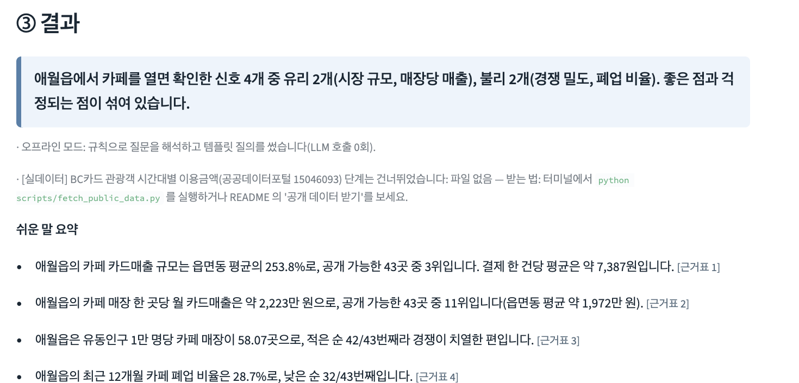

# 우리 동네 장사 지도



- **질문 한 문장**("애월읍에 카페를 내면 어때?")으로 제주 동네 장사 진단을 받는 AI Agent입니다. 제주 AI·빅데이터 활용 AI Agent 개발 챌린지 출품작(1차 동작본).
- 계획 에이전트가 필요한 표와 "센터에서 받아 올 CSV"를 안내하고, 로컬 도구(DuckDB·그래프)가 계산하며, **반출 기준 검사기(export_gate)**를 통과한 집계만 해설 에이전트가 쉬운 말로 풉니다.
- **키 없이도 끝까지 도는 오프라인 모드가 기본**입니다. OpenAI·Claude·Gemini 는 키를 넣을 때만 선택으로 씁니다.

**데모 링크: [jeju-jangsa-map.streamlit.app](https://jeju-jangsa-map.streamlit.app)** · **대표 GitHub: [ai-specialtime/jeju-jangsa-map](https://github.com/ai-specialtime/jeju-jangsa-map)**(팀 AI특별시) · **센터 PC에서: `install.bat` → `run.bat`** (macOS/Linux: `./install.sh` → `./run.sh`)

> 화면의 숫자 대부분은 **가상 데이터**입니다(실제 제주 통계 아님). 공개 실데이터를 쓴 단계에는 `[실데이터]` 표시가 붙습니다. 센터에서 받은 실제 CSV 를 올리면 같은 화면이 실제 분석을 합니다.

> 본 자료는 제주빅데이터센터에서 제공하는 자료를 활용한 것이며, 연구결과는 제주특별자치도 및 제주테크노파크와 관련이 없음을 밝힙니다.

팀: AI특별시 · 코드 라이선스: [MIT](LICENSE) (데이터는 아래 "데이터 출처·이용조건"을 따릅니다)

## 설치와 실행

| | Windows 11 (센터 PC) | macOS / Linux |
|---|---|---|
| 설치(처음 한 번) | `install.bat` 더블클릭 | `./install.sh` |
| 실행 | `run.bat` 더블클릭 → 브라우저가 열림 | `./run.sh` |

- Python 3.11. 직접 설치하는 패키지는 `requirements.txt`(고정 버전) **8개**(streamlit, duckdb, pandas, numpy, plotly, PyYAML, pydantic, matplotlib)입니다. 이 8개가 끌고 오는 의존 패키지까지 모두 고정한 **전체 47개 목록은 [requirements-lock.txt](requirements-lock.txt)**(깨끗한 환경에서 뽑음), 패키지별 라이선스는 [docs/data-usage.md](docs/data-usage.md) 6절입니다. torch·Docker·WSL 은 쓰지 않습니다.
- 가상 데이터 CSV 는 저장소에 넣지 않고 설치 때(또는 앱을 처음 열 때, 없으면 자동으로) `scripts/make_synthetic.py`(고정 시드, 약 3초, 33MB)로 만듭니다.
- 테스트: `.venv/bin/python -m pytest tests -q` (Windows: `.venv\Scripts\python -m pytest tests -q`) → 86개 통과(저장소만 받은 환경에서는 받아야 하는 공개 파일이 필요한 2개를 건너뛰고 84개 통과; 스크린샷: docs/screens/).

### 공개 데이터 받기 (선택)
`data/public/` 에는 이용조건이 "이용허락범위 제한 없음"으로 확인된 파일(제주도민 유동인구, 버스 정류소·노선 등)만 들어 있습니다. 이용조건을 확인하지 못했거나 안내가 어긋나는 **서귀포시 휴게음식점 현황(제주데이터허브 1306)과 BC카드 관광객 지역별 분석(공공데이터포털 15046093)**은 저장소에 없고, 필요하면 원래 공개 주소에서 받습니다(로그인·키 불필요, 받기 전에 출처 페이지의 이용조건을 확인하세요).

```
python scripts/fetch_public_data.py --check   # 있는지 없는지만 보기
python scripts/fetch_public_data.py           # 없는 것만 받기
```
받지 않아도 앱은 돌아갑니다. 그 [실데이터] 단계만 "파일 없음 — 받는 법" 안내로 건너뜁니다.

### 공개 데모 (Streamlit Community Cloud)
메인 파일 `app.py`, Python 3.11(`.python-version`, `runtime.txt`), 한글 글꼴은 `packages.txt`(fonts-nanum), 화면 설정은 `.streamlit/config.toml`입니다. 데모는 **오프라인 모드가 기본**이고 가상 데이터를 첫 실행 때 자동으로 만듭니다(메모리는 데이터·분석 부분이 세션 3개 동시에 약 470MB로 1GB 안). LLM 모드의 API 키는 그 브라우저 세션의 메모리에만 있고 서버에 저장하지 않습니다. 공개 데모에는 본인 키를 넣지 마세요. `JANGSA_DEMO=1` 환경변수(Cloud 에서는 자동 인식)이면 이 안내 문구가 더 붙고, **저장소에 없는 공개 파일 2종(휴게음식점·BC카드)을 첫 실행 때 원래 공개 주소에서 받아 서버가 켜져 있는 동안 씁니다**(`jangsa/fetch_public.py`, 요청마다 20초까지 기다리고, 받기에 실패하면 그 [실데이터] 단계만 "파일 없음" 안내로 건너뜁니다; 받은 파일은 커밋하지 않습니다). 센터 PC(`run.bat`)에서는 이 자동 받기를 하지 않고 위 '공개 데이터 받기'를 손으로 합니다.

## 화면 사용법 (자세한 건 [docs/manual.md](docs/manual.md))
1. 예시 질문 버튼을 누르거나 직접 질문을 씁니다. 예) "애월읍에 카페를 내면 어때?", "노형동 한식집 매출이 동네 평균보다 어때?"
2. "이렇게 이해했어요"에서 동네·업종이 맞는지 확인하고, "센터에서 받아 올 CSV 체크리스트"를 봅니다.
3. 왼쪽에서 센터 CSV 를 올리면(CP949·UTF-8 자동) 열을 자동으로 맞춥니다. 안 올리면 가상 데이터로 체험합니다.
4. 결과: 한 줄 결론 + 쉬운 말 요약 + 그래프 + 근거표 + 한계. 아래에서 보고서(HTML)를 저장하고 "분석 기록"에서 실행한 SQL·사용 파일·반출 검사 결과·LLM 호출 수와 예상 비용을 봅니다.
5. 내 가게 월 매출 CSV(연월·매출 두 열)를 올리면 동네 평균과 견줍니다. 끝나면 "올린 자료 모두 삭제"를 누르세요.

## 분석 방식
- **오프라인 모드(기본)**: 규칙으로 질문을 해석하고 템플릿 질의·템플릿 해설을 씁니다. 외부 전송 0건, 비용 0원, 같은 질문은 항상 같은 결과입니다.
- **LLM 모드**: 화면에서 공급자(OpenAI·Claude·Gemini)와 키를 넣거나 `.env`(`.env.example` 참고)에 키를 적습니다. 온도 0, 질문당 호출 최대 4회, 생성 SQL 은 `runs/plans/` 에 저장돼 같은 질문이 같은 SQL 로 재현됩니다. SQL 이 실패하면 오류를 넣어 최대 2회 고치고, 그래도 안 되면 템플릿 질의로 대체합니다. 시스템 환경변수나 다른 폴더의 키 파일은 읽지 않습니다.
- LLM 에 무엇이 가고 무엇이 안 가는지는 [docs/llm-boundary.md](docs/llm-boundary.md).

## 데이터 출처·이용조건
- 센터 표 열 명세: 제주데이터허브 데이터명세서 v12(2026.1.28)와 반출 기준(2026.09.01 개정) → `config/tables.yaml`, `config/export_rules.yaml`. 조사 원문은 [docs/data-spec.md](docs/data-spec.md).
- 공개 실데이터: 저장소에 포함 — 제주도민 시간대별 유동인구(PNU), 버스정류소 현황 외(이용조건 확인됨). 받아서 쓰는 것 — 서귀포시 휴게음식점 현황, BC카드 개별관광 지역별 분석(`scripts/fetch_public_data.py`). 이용조건·출처·한계는 [docs/data-usage.md](docs/data-usage.md). **제주빅데이터센터 데이터와 공개 데이터는 각 제공처의 이용조건을 따릅니다**(MIT 라이선스는 이 저장소의 코드·문서에만 적용).
- 출처 표기: "본 자료는 제주빅데이터센터에서 제공하는 자료를 활용한 것이며, 연구결과는 제주특별자치도 및 제주테크노파크와 관련이 없음을 밝힙니다." (화면 하단과 보고서에 항상 표시)

## 제약사항 (솔직하게)
- 센터 표의 열 이름은 명세서로 맞췄지만 **실제 센터 CSV 로는 아직 돌려 보지 못했습니다**(센터 방문 전). 명세와 다르면 열 이름을 `config/tables.yaml` 의 `aliases` 한 곳에서 고칩니다.
- 센터 `1-17 업종별 매장 수`는 시군구 단위이고 `2-08 휴폐업`은 기업별 원본 행(식별 정보 포함)이라, 읍면동별 매장 수·폐업률은 센터 안에서 집계한 CSV(`store_emd`, `closure`)가 있을 때만 쓰입니다. 없으면 그 단계는 빠지고 카드·유동인구 위주로 분석합니다.
- 센터 업종코드 42개에는 치킨·분식이 따로 없습니다(`간이음식`=피자·햄버거·샌드위치로 가까운 업종을 고르게 안내).
- 카드 표의 법정동(bjd)→행정동 매핑은 확실한 것만 넣은 초안입니다. 매핑 안 되는 동은 경고 후 분석에서 빠집니다.
- 반출 기준 문서 안의 충돌(4쪽 vs 10쪽)은 **엄격 모드(기본)**로 처리했고 센터에 확인이 필요합니다.
- 일별 날씨·버스 이용(승하차) 실데이터는 공개 파일이 없어 날씨 단계는 가상 데이터입니다. 로컬 소형 LLM(Ollama)은 아직 없습니다.
