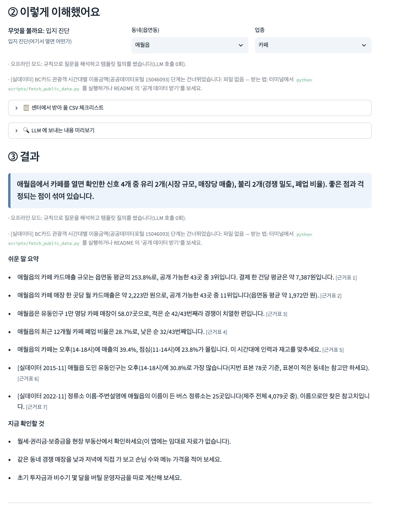
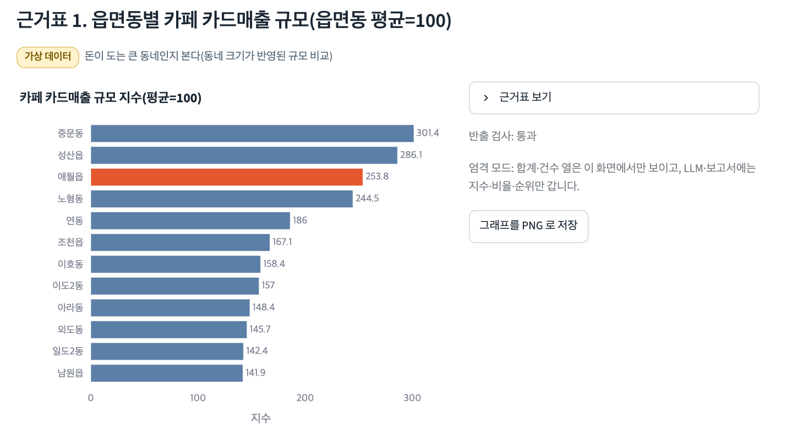

# 결과 설명자료: 우리 동네 장사 지도

제주 AI·빅데이터 활용 AI Agent 개발 챌린지 최종 산출물의 결과 설명자료입니다. 새로운 주장은 담지 않고, 기획서(`docs/proposal/기획서_우리동네장사지도.pdf`)와 저장소 문서·코드·테스트에서 확인되는 내용만 정리했습니다. 자세한 근거 문서는 각 절 끝에 적었습니다.

> 화면·예시의 숫자 대부분은 **가상 데이터**(센터 명세의 열 이름·형식으로 만든 시연용)이며 실제 제주 통계가 아닙니다. 공개 실데이터를 쓴 단계에는 `[실데이터]` 표시가 붙습니다.
> 본 자료는 제주빅데이터센터에서 제공하는 자료를 활용한 것이며, 연구결과는 제주특별자치도 및 제주테크노파크와 관련이 없음을 밝힙니다.

## 1. 문제 정의

- 제주에서 가게를 내려는 사람은 동네별 카드매출·유동인구·경쟁(매장 수)·폐업 자료를 한 번에 보기 어렵습니다. 센터에는 표가 73종 있지만 어떤 표를 어떤 조건으로 받아 어떻게 묶는지는 비전문가가 알기 어렵습니다.
- 센터의 반출 불가 데이터는 외부 LLM으로 보낼 수도 없습니다(운영진 답변 2026-10-30: 원본·원본 조회 결과는 어렵고, 반출 기준을 충족하는 집계·가공 결과는 전송 가능).
- 그래서 "질문 한 문장 → 필요한 표 안내 → 로컬 계산 → 반출 검사 → 쉬운 해설"을 한 번에 하는 Agent로 주제를 좁혔습니다. 창업 여부는 대신 정하지 않고, 확인한 신호(유리·불리)를 근거표와 함께 보여 줍니다.
- 근거: 기획서 1장, `README.md`

## 2. Agent 구조

계획 → 실행 → 검사 → 해설 4단계입니다(기획서 3장 그림 7).

| 구성 | 역할 | 코드 |
|---|---|---|
| 계획 에이전트 | 질문 유형 5종·동네·업종 해석, 필요한 표와 "센터에서 받아 올 CSV" 체크리스트, 분석 단계(SQL·그래프) 결정. 오프라인은 규칙+템플릿, LLM 모드는 표 설명과 질문만 보내 JSON 계획을 받음 | `jangsa/agents/planner.py`, `rules.py`, `templates.py` |
| 도구 실행기(로컬, LLM 없음) | `csv_profile`(열 자동 맞춤), `sql_run`(DuckDB, SELECT만·집계·LIMIT 강제), `export_gate`(반출 기준 검사), `chart`(plotly·PNG), `benchmark`(내 가게 백분위) | `jangsa/tools/` |
| 해설 에이전트 | 반출 검사를 통과한 집계표만으로 쉬운 문장·`[근거표 N]`·한계를 씀. LLM 해설의 숫자가 표에 없으면 템플릿 해설로 교체 | `jangsa/agents/explainer.py`, `narrate.py` |
| 파이프라인 | 위 단계를 잇고 분석 기록을 남김 | `jangsa/pipeline.py`, `runlog.py` |

- 기본은 **키 없이 끝까지 도는 오프라인 모드**(외부 전송 0건, 비용 0원, 같은 질문은 같은 결과)입니다. OpenAI·Claude·Gemini는 키를 넣을 때만 선택으로 씁니다(온도 0, 질문당 호출 최대 4회, SQL 실패 시 오류를 넣어 최대 2회 수정 후 템플릿 질의로 대체).
- LLM에 가는 것과 안 가는 것: `docs/llm-boundary.md`

## 3. 주요 기능

1. 질문 이해 확인: "이렇게 이해했어요"로 동네·업종 확인, 틀리면 목록에서 고쳐 재분석
2. 센터에서 받아 올 CSV 체크리스트(표 번호·이름·받을 조건)
3. 센터 CSV 올리기, 인코딩(UTF-8·CP949)·열 이름 자동 맞춤
4. 결과 해설: 한 줄 결론, 쉬운 문장 요약(문장마다 근거표 번호), 그래프, 근거표, 한계
5. 내 가게 월 매출 CSV와 동네 평균 비교(금액은 화면 안에서만 사용)
6. 1~2쪽 HTML 보고서, 분석 기록(SQL·사용 파일·행 수·반출 검사 결과·LLM 호출 수·예상 비용), LLM 전송 내용 미리보기
7. "올린 자료 모두 삭제"
8. 반출 기준 검사기 `export_gate`: 원본 행·식별 열 차단, 근거 10 미만 칸 가림, 응용집계(지수·비율·순위)만 반출, 엄격 모드 기본(`config/export_rules.yaml`)

사용법: `docs/manual.md`

## 4. 실행 결과

`docs/screens/`의 화면은 가상 데이터 기준 실제 캡처입니다.

| 화면 | 파일 |
|---|---|
| 첫 화면(예시 질문 6개, 분석 방식, CSV 올리기) | `docs/screens/01-첫화면.png` |
| 결과: 한 줄 결론·쉬운 요약 | `docs/screens/02a-result-summary.png` |
| 결과: 근거 그래프 | `docs/screens/02b-result-chart.png`, `hero.png` |
| 결과 전체(애월읍 카페) | `docs/screens/02-result-애월읍-카페.png` |
| 센터 CSV 체크리스트 | `docs/screens/03-csv-checklist.png` |
| CSV 올리기와 열 맞춤 | `docs/screens/07-csv-upload-mapping.png` |
| LLM에 보내는 내용 미리보기 | `docs/screens/04-llm-preview.png` |
| 분석 기록 | `docs/screens/05-analysis-log.png` |
| 보고서 | `docs/screens/06-report.png` |

오프라인 모드로 예시 질문을 돌린 결과(가상 데이터, 이 저장소의 코드로 재현됩니다):

| 질문 | 한 줄 결론(발췌) | 분석 단계 | 반출 검사 |
|---|---|---|---|
| 애월읍에 카페를 내면 어때? | 확인한 신호 4개 중 유리 2개(시장 규모, 매장당 매출), 불리 2개(경쟁 밀도, 폐업 비율) | 8 | 전부 통과 |
| 성산읍에 카페가 너무 많은가요? | 서귀포시 카페 매장은 2024-10 대비 2026-09에 +9.6% 변함(센터 표는 시 단위) | 5 | 전부 통과 |
| 중문동 카페는 몇 시에 제일 잘 돼? | 오후(14-18시)에 매출의 39.1%, 점심(11-14시)에 23.4% | 6 | 전부 통과 |

기획서 1.3절의 달성 기준: 예시 질문 6개가 키 없이 결론·그래프·근거표·한계까지 나옴, 데이터 불러오기 약 4초·질문 1건 0.02~0.2초(macOS 개발 PC).

## 5. 검증 방법과 한계

**수행한 검증**
- 자동 테스트: `python -m pytest -q` → **92개 통과**(공개 파일 2종까지 받아 둔 개발 PC 기준). 저장소·zip만 받은 깨끗한 환경에서는 받아야 하는 공개 파일이 필요한 5개를 건너뛰고 **87개 통과**. 구성: 반출 검사 9, SQL 안전 25, CSV 맞춤 8, LLM 공급자·대체 동작 12, 공개 데이터 6, 공개 파일 받기 10, 가상 데이터 재현 6, 오프라인 끝-끝 16. 기획서의 테스트 수도 92개로 맞췄습니다.
- 모든 요약 문장에 근거표 번호, 한계 문장, 가상/실데이터 딱지, 소수 칸 "비공개"
- 재현: 고정 시드(20261030)·고정 버전(`requirements.txt`, `requirements-lock.txt`), 오프라인은 같은 질문에 같은 결과, LLM 모드는 생성 SQL 저장, 분석 기록 파일

**하지 못한 검증 / 한계**
- 센터의 실제 CSV로는 아직 돌려 보지 못했습니다(센터 방문 전). 열 이름이 다르면 `config/tables.yaml`의 `aliases` 한 곳에서 고칩니다.
- Windows 11 실기 설치는 하지 못했습니다(`install.bat`·`run.bat`은 작성만, macOS에서 확인).
- LLM 모드의 실제 외부 API 호출 시험은 하지 않았습니다(요청 형식·응답 해석·실패 대체는 가짜 전송으로 시험).
- 평가용 질문을 직접 SQL과 대조하는 검증표는 아직 없습니다.
- 카드 결제 금액만 반영(현금·계좌이체 제외), 과거 자료이며 미래를 보장하지 않음, 임대료·권리금 자료 없음.
- 공개 실데이터의 시점·범위가 제한적(관광객 카드 2015-09~2016-08, 도민 유동인구 2015-11, 휴게음식점 서귀포시 2023-03 등).
- 센터 카드 업종코드 42개에 치킨·분식이 없고, 법정동→행정동 대응표는 확실한 것만 넣은 초안, 일별 날씨는 가상 데이터.
- 반출 기준 문서의 4쪽과 10쪽 해석 충돌은 엄격 모드(기본)로 처리했고 센터 확인이 필요합니다.
- 근거: 기획서 6장, `README.md` "제약사항", `docs/data-usage.md`

## 6. 센터 활용 방안

- 센터 방문 도민의 데이터 상담 창구용 도구로, 질문을 받으면 체크리스트대로 받을 CSV를 안내합니다.
- 센터 PC(Windows 11, CPU만 사용)에서 `install.bat` → `run.bat` 두 번 클릭으로 실행합니다. 데이터는 로컬 DuckDB 메모리에만 있고, 센터 시스템에는 접속하지 않습니다(API 직접 연결 미지원).
- 오프라인 모드는 API 비용 없이 상시 운영할 수 있고, LLM 모드는 센터가 키를 넣을 때만 켭니다.
- 필요한 센터 확인 사항(PyPI 접근 또는 패키지 사전 설치, LLM API 도메인 허용, 반출 기준 해석 등)은 기획서 6.4절에 정리했습니다.
- 확장 계획(현재 없음): 외식업 POS 표, 단기체류 외국인 유동인구 추가, 일별 날씨·버스 이용 실데이터 연결, 로컬 소형 LLM.
